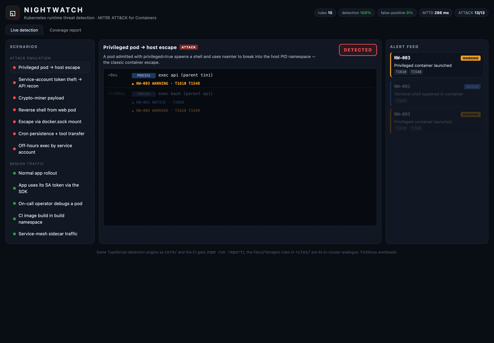
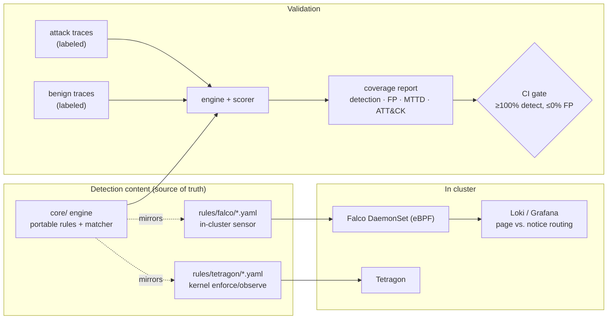

# NIGHTWATCH

**Kubernetes runtime threat detection, engineered and scored like code.**

NIGHTWATCH is a detection-engineering project for the container runtime. It
pairs a ruleset — written as Falco rules, Tetragon tracing policies, and a
portable TypeScript engine — with a labeled corpus of **attack** and **benign**
runtime-event traces, then scores every rule for detection rate, false-positive
rate, mean-time-to-detect and **MITRE ATT&CK for Containers** coverage. The score
runs as a CI gate, so a change that silences a detection or adds a noisy rule
fails the build.

Detection content is only credible if you can show it fires on real attacks and
stays quiet on real workloads. NIGHTWATCH makes that evidence runnable.



**Live demo:** https://nightwatch-detections.vercel.app · streams each attack
through the engine, lights up the ATT&CK matrix, and shows the coverage scorecard.

---

## Headline

```
rules loaded          15
attack scenarios      7  detected 7  (100%)
benign scenarios      5  false positives 0  (0%)
mean time to detect   286 ms (first page-worthy alert)
ATT&CK techniques     13/13 exercised covered
```

Generated by `npm run report`, which exits non-zero if detection drops below
100% or the false-positive rate rises above 0% — the gate wired into CI.

## What it detects

15 rules across the container-relevant ATT&CK tactics — Execution, Persistence,
Privilege Escalation, Defense Evasion, Credential Access, Discovery, Lateral
Movement, Command & Control and Impact. Highlights:

| Rule | Detects | ATT&CK |
|------|---------|--------|
| NW-002 | Namespace break-out (`nsenter`/`setns`) — container escape | T1611 |
| NW-004 | SA token read **by a shell/tool** (SDK reads stay quiet) | T1552.007 |
| NW-006/007 | Crypto-miner binary / stratum pool connection | T1496 |
| NW-010 | Reverse-shell pattern (`/dev/tcp`, `nc -e`) | T1059, T1071 |
| NW-011 | Sensitive host-path read (`docker.sock`, host `/proc`) | T1611 |
| NW-015 | `pods/exec` by a **service account**, not a human operator | T1078, T1021 |

The interesting work is the tuning: NW-004 fires on `curl`/`sh` reading the
service-account token but not on the app's own binary; NW-015 separates a stolen
service-account exec'ing into a pod from an on-call engineer doing the same — the
difference between a page and a notice.

## Detection as code



The TypeScript engine in `core/` is the executable specification. The Falco and
Tetragon rules in `rules/` are the same logic in the form the cluster actually
loads. The `attack/` scripts reproduce each scenario against a disposable test
namespace so you can watch the real sensors fire; `runbooks/` has the IR response
for the critical paths; `deploy/k8s/` has the Falco DaemonSet, Loki alert routing
(page on critical / warning-burst, notice feed for the rest) and a drop-in
quarantine NetworkPolicy.

## Certification mapping

- **CKS (Certified Kubernetes Security Specialist)** — runtime security with Falco
  & Tetragon, Pod Security, eBPF sensors, audit logging, supply-chain/admission
  context, incident response. This is the CKS "Monitoring, Logging & Runtime
  Security" domain, made concrete.
- **CompTIA PenTest+ / CySA+** — the `attack/` corpus is the offense (escape,
  token theft, reverse shells, crypto-mining, persistence); the scoring harness
  and ATT&CK mapping are the analyst/defender side.

## Run it

```bash
npm install
npm test               # unit tests: 100% detection, 0% FP, technique coverage
npm run report         # the CI coverage gate (add -- --json for machine output)
npm run dev            # browser console; ?auto runs the scripted walkthrough
```

Validate against a real cluster you own (kind/minikube + Falco):

```bash
kubectl apply -f deploy/k8s/falco-daemonset.yaml
NS=nightwatch-test ./attack/run-all.sh
kubectl logs -n falco ds/falco | grep NW-
```

## Layout

```
core/        detection engine, ruleset, ATT&CK map, scenarios, CI report
rules/falco/ Falco rules (syscalls + k8s audit) — the in-cluster analogue
rules/tetragon/ Tetragon TracingPolicy (kernel observe/enforce)
attack/      emulation scripts, one per scenario, for a disposable test namespace
runbooks/    IR runbooks for the critical detections
deploy/k8s/  Falco DaemonSet, Loki alert routing, quarantine NetworkPolicy
src/         browser console — same engine, live stream + ATT&CK matrix
```

> Lab project. Workloads, namespaces and IOCs are fictitious; emulation scripts
> use harmless stand-ins and are for clusters you are authorized to test.
